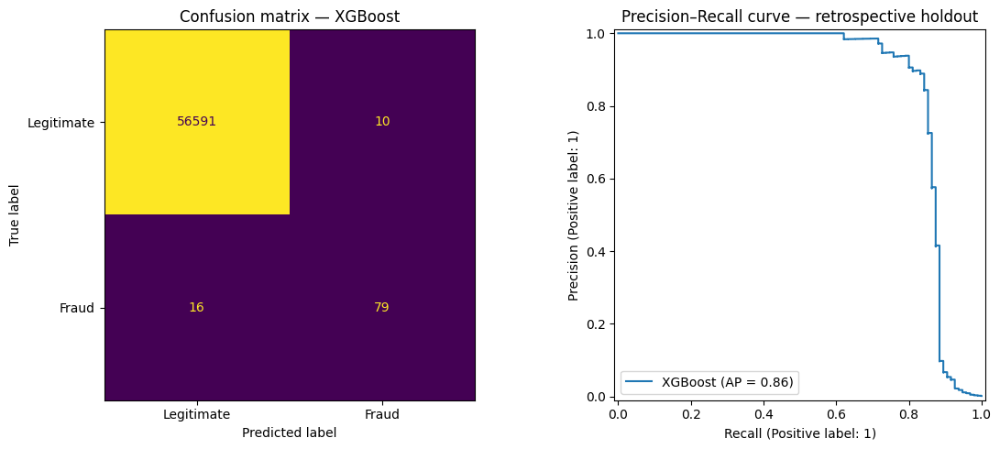
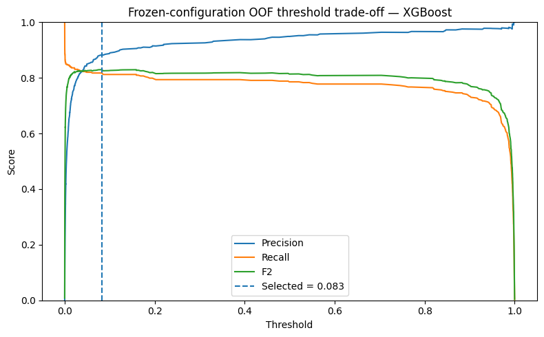
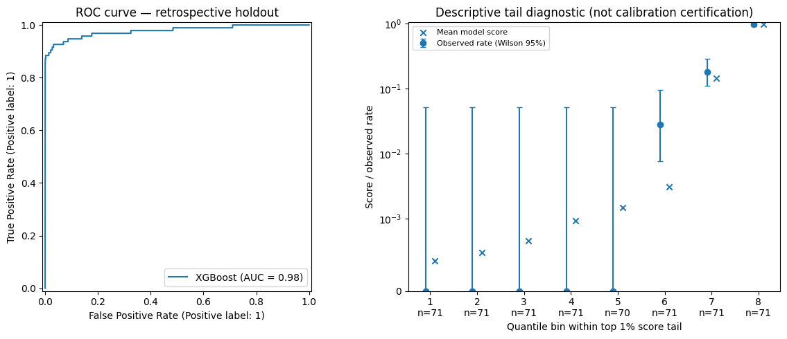

# Credit Card Fraud Detection

**Statistical modelling · Risk analytics · Imbalanced classification**

This project was developed as part of my MSc in **Artificial Intelligence Technology with Advanced Practice at Northumbria University London**, completed in May 2026 with an original academic mark of **85/100 (Distinction)**. This portfolio edition includes sanitisation and technical updates. The original mark applies to the academic submission.

[Executed analysis notebook](notebooks/credit_card_fraud_detection.ipynb) · [Technical report (PDF)](reports/credit-card-fraud-detection-report.pdf) · [Machine-readable results](results.json) · [Public dataset](https://www.kaggle.com/datasets/mlg-ulb/creditcardfraud)

## Results at a glance

An XGBoost model selected by mean outer-fold Average Precision (AP) detected **79 of 95 fraud cases with just 10 false positives** on a retrospective holdout of 56,696 transactions. The operating threshold was chosen using out-of-fold development predictions, not the holdout. A separate chronological evaluation achieved **93.22% precision and 74.32% recall** on 55,026 transactions whose stored feature fingerprints had not appeared in the earlier time windows.

| Metric | Retrospective grouped holdout | Chronological restricted future |
|---|---:|---:|
| Transactions | 56,696 | 55,026 |
| Fraud cases | 95 | 74 |
| Average Precision | **0.8622** | **0.7961** |
| ROC-AUC | 0.9780 | 0.9840 |
| Precision | 88.76% | 93.22% |
| Recall | 83.16% | 74.32% |
| F1 | 0.8587 | — |
| F2 | 0.8422 | 0.7746 |
| True positives / false positives | 79 / 10 | 55 / 4 |

These are different retrospective evaluation protocols, with different populations, fitted models and operating thresholds. They are not a head-to-head comparison or external prospective validation.

## Problem and data quality

Fraud detection is a rare-event decision problem: missed fraud can cause financial loss, while unnecessary alerts increase review workload and disrupt legitimate payments. Overall accuracy alone is uninformative under extreme imbalance.

The anonymised ULB/Kaggle dataset contains 284,807 transactions, including 492 fraud labels, over two days in September 2013. Removing 1,081 exact duplicate rows leaves 283,726 transactions and 473 fraud labels. Records sharing the stored 64-bit fingerprint of `V1`–`V28` and `Amount` are grouped to prevent overlap across the specified random partitions. The model uses those 29 features; `Time` is reserved for audit and chronological evaluation. Fingerprint disjointness does not establish entity independence or all notions of feature equivalence.

The dataset is not redistributed. Obtain it from the [original Kaggle dataset](https://www.kaggle.com/datasets/mlg-ulb/creditcardfraud). Its verified benchmark CSV SHA-256 is `30543a537fafc51d9775188bb2ed015ced07d7ca6ab416433fb62050850e19d8`.

## Methodology

1. **Development-only exploration.** Investigated feature distributions, outliers and correlations, scaling and class-imbalance treatments. Compared 19 exploratory procedures, including linear, tree-based, neighbourhood and neural approaches. Scaled and resampled only inside the relevant training pipeline. Extreme amounts were retained.
2. **Grouped nested cross-validation.** Compared eight candidate procedures using three outer and three inner folds; Random Forest and XGBoost tuning was performed within the respective outer-training partitions. Selected the fixed XGBoost preset by mean outer-fold AP (0.84436, SD 0.01500), not a composite score or holdout ranking. The preset used 400 trees, depth 6, learning rate 0.08 and sampling fractions 0.85. It was not the tuned variant. The paired conditional AP difference against the tuned procedure did not establish superiority.
3. **Operating-point optimisation.** After freezing the model configuration, used grouped out-of-fold development predictions to maximise F2, obtaining threshold 0.0827833. Evaluated the frozen model on the grouped holdout without retuning. This threshold gives more weight to missed fraud; it is not a bank-specific financial cost function.
4. **Uncertainty and alert capacity.** Computed conditional 95% grouped-bootstrap intervals with 2,000 draws. At a prespecified 0.1% holdout alert fraction, the 57 highest-ranked transactions were all frauds, capturing 60% of the 95 labelled frauds. At 0.25%, 142 alerts captured 86.32% of frauds at 57.75% precision. These are retrospective batch-review quantities, not production alert-rate guarantees.
5. **Chronological evaluation.** Independently selected a model using past and validation windows, froze its threshold and evaluated the restricted future and full future windows. The two future cohorts use the same temporal model and threshold; they overlap the random-split population.

### Conditional holdout uncertainty

| Metric | Estimate | Conditional 95% interval |
|---|---:|---:|
| AP | 0.8622 | 0.7912–0.9263 |
| ROC-AUC | 0.9780 | 0.9563–0.9943 |
| Precision | 0.8876 | 0.8163–0.9490 |
| Recall | 0.8316 | 0.7549–0.9059 |
| F2 | 0.8422 | 0.7731–0.9035 |

The intervals condition on the frozen model, scores, threshold and observed fingerprint clusters. They do not account for model selection, refitting, alternative splits or hidden entities.

## Reproducibility and scope

The benchmark was trained on CPU on 24 November 2026. A matched-runtime reporting replay on 26 November consumed 57 verified historical work units without retraining; 20 strict inference checks passed, including exact score parity for the original exported model. The code and aggregate outputs are available in the executed notebook; the recorded direct dependency versions are in `requirements.txt` (not a complete dependency lock). The report documents the methods, validation, responsible-AI considerations and hypothetical cloud deployment feasibility.

The public notebook is a display derivative of the executed replay: code, numerical output and ten plots are preserved, with static HTML tables and nonessential execution metadata removed. It is intended to be read, not re-executed with Run All. The original model export, checkpoint snapshot and dataset are not included; a fresh end-to-end training run has not been certified. Historical training timings are not a production latency benchmark.

### Limitations

- The dataset was examined in the earlier academic workflow, including test-derived comparisons. This evaluation is retrospective, not a previously unseen external test; the earlier CSV digest is unavailable. Selection and threshold tuning in the revised benchmark use development data programmatically.
- The recorded scikit-learn 1.6.1 grouped splitter has a known shuffle-related group-count mapping issue. Group boundaries were verified, but fold assignments are not guaranteed to be reliably stratified. The upstream PCA fitting population and hidden cardholder identities are unknown.
- The chronological cohorts are drawn from the same historical dataset and overlap the random split; observed differences do not establish causal drift. Calibration is diagnosed, not optimised. No subgroup fairness, production deployment or calibrated fraud-probability claim is made.

## Repository contents

- `notebooks/credit_card_fraud_detection.ipynb` — full executed analysis with code and outputs
- `reports/credit-card-fraud-detection-report.pdf` — technical portfolio report
- `figures/` — ten original experiment plots extracted from the executed notebook
- `results.json` — selected aggregate metrics, intervals and provenance
- `requirements.txt` — recorded scientific and replay dependencies

## Author and academic context

Alberto Reyes Castro · Physics graduate · MSc Artificial Intelligence Technology student

[Portfolio](https://albertoreyescastro.github.io) · [GitHub](https://github.com/albertoreyescastro) · [LinkedIn](https://www.linkedin.com/in/albertoreyescastro/)

Acknowledgements: Northumbria University London, the ULB Machine Learning Group and Kaggle. The repository does not redistribute the source dataset or claim deployment within a financial institution.
